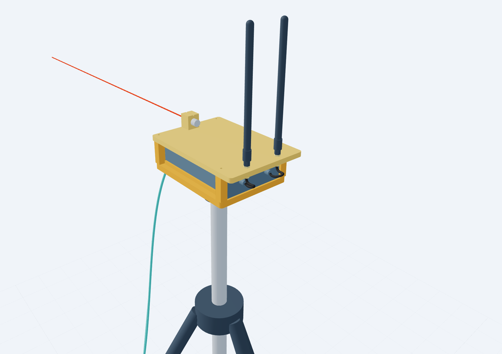
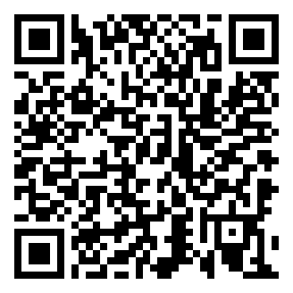
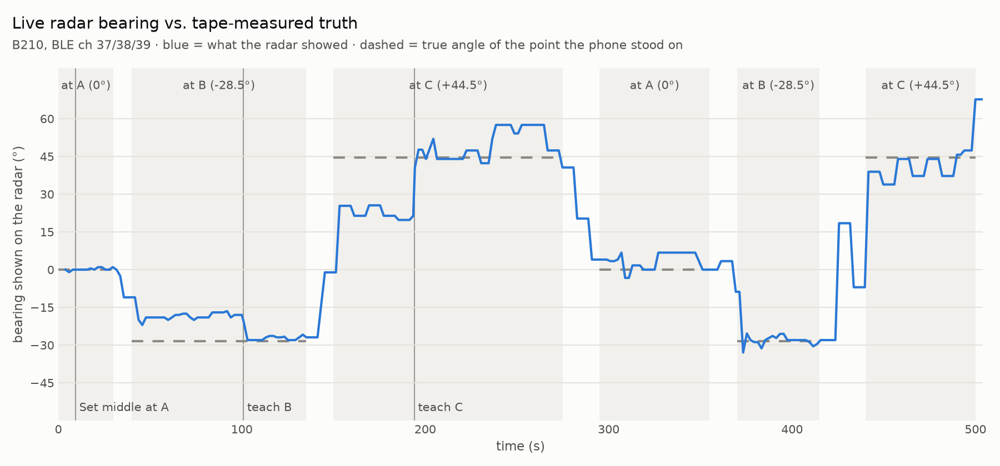
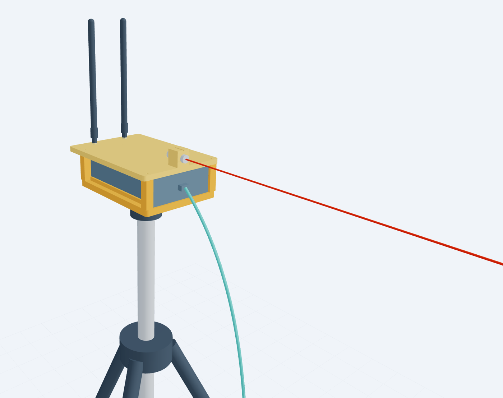
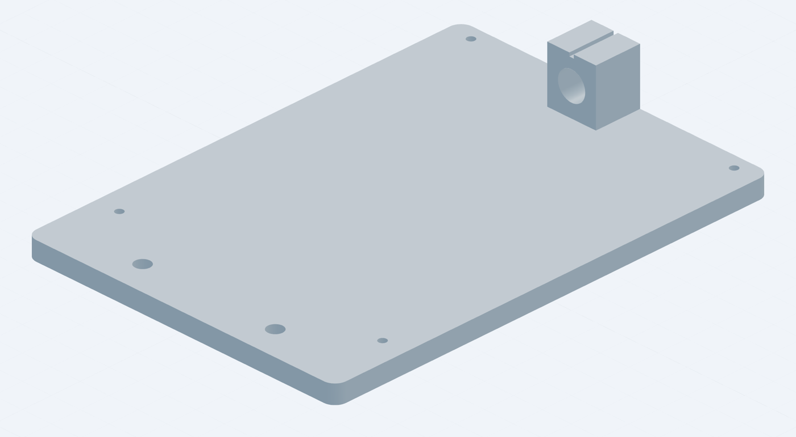
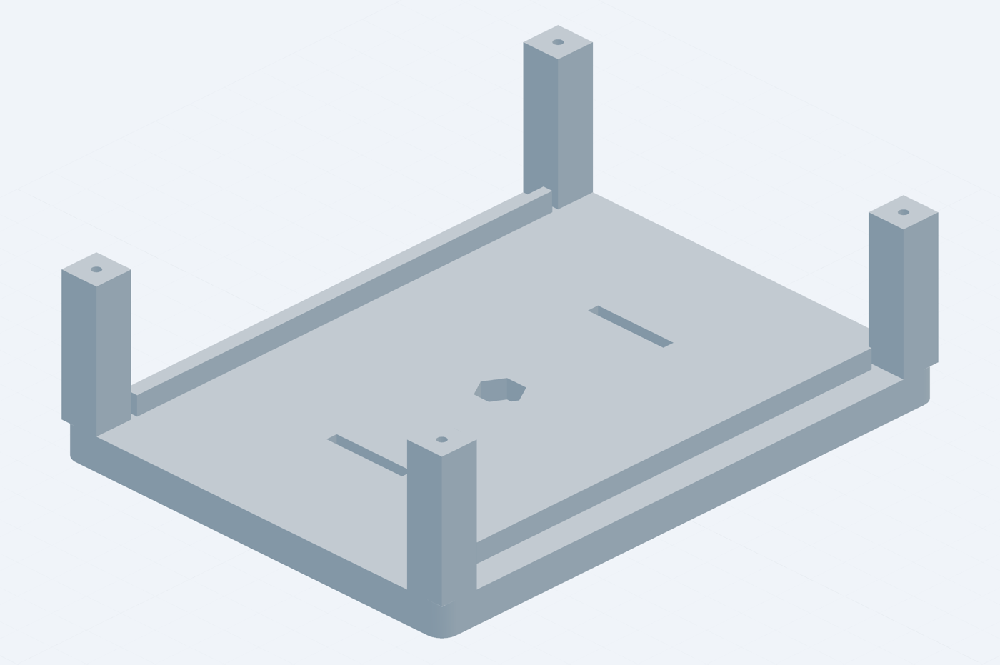

<div align="center">

# Drone & BLE RF Analysis with a USRP B210

**Thesis project, University of Cyprus, Computer Science.**
Live direction finding of Bluetooth LE devices with a 2-antenna USRP B210, plus drone RF traffic analysis, jamming, replay and GPS-spoofing experiments.

[](https://github.com/AntoniosKalattas/DoA-using-only-one-USRP/releases/latest)
[](https://github.com/AntoniosKalattas/DoA-using-only-one-USRP/actions/workflows/release.yml)




</div>

---

## What it does

A phone (or any BLE device) advertises. The B210 receives it on **two coherent antennas**, and the
**Capture Console** works out *where* it is and draws it on a live radar in the browser:

1. **Hop** across the three BLE advertising channels (37 → 38 → 39, 300 ms each).
2. **Decode** every advertising packet and check its CRC. The phone app is recognised by its tag.
3. **Bearing:** remove each channel's own phase offset, then run **MUSIC** on the two antennas.
   Taught reference points correct the angle where the room bends it.
4. **Distance:** average the signal power over the three channels, so a reflection on one channel
   doesn't throw it off, correct it for direction, and smooth it. It is shown as a *range band*,
   not a single number.
5. **Calibrate on site** in about five minutes. Stand at a tape-measured point and press **Set middle**, **Set distance** and **Set angle**.

## Install

| | |
|---|---|
|  | **Phone app (Android):** scan the QR code, or open [UsrpBeacon.apk](https://github.com/AntoniosKalattas/DoA-using-only-one-USRP/releases/latest/download/UsrpBeacon.apk) on the phone and install it. iPhone: build `ios/UsrpBeacon` in Xcode. |
| **macOS / Linux** | `curl -fsSL https://github.com/AntoniosKalattas/DoA-using-only-one-USRP/releases/latest/download/install.sh \| bash` |
| **Windows 10/11** | PowerShell: `irm https://github.com/AntoniosKalattas/DoA-using-only-one-USRP/releases/latest/download/install.ps1 \| iex` |
| **Docker (Linux)** | `docker pull ghcr.io/antonioskalattas/usrp-console:latest`, then `docker compose -f docker/docker-compose.yml up -d` |

The setup wizards check and install what's missing: UHD and the B210 firmware, a Python
environment, the B210 streamer, an optional ngrok link for the phone, and a launcher. On Windows the
console runs in Docker inside WSL2, and the B210 is passed through with usbipd. Then open
**http://localhost:8099/radar**.

## Results so far

<picture>
  <source media="(prefers-color-scheme: dark)" srcset="docs/images/radar_vs_truth_dark.png">
  
</picture>

Live run on 26 Nov 2026: the antennas on a table, the phone held at three tape-measured points.

| Point (true) | Angle shown | Distance shown |
|---|---|---|
| A, 0°, 8 m | 0° to +7° | 7.3–9.6 m |
| B, −28.5°, 9 m | −26° to −30° | 8.4–8.9 m |
| C, +44.5°, 9 m | +34° to +57° | 10.1–10.5 m |

C is the weak spot: reflections squash the array's response on that side, so the correction has
to stretch it and small wobbles grow. The tripod pod below is meant to fix that, by lifting the
antennas clear of the table and the ground.

## Field pod (3D model)

The whole receiver is **one pod** that screws onto any camera tripod's **1/4"-20 screw**. The pod
holds the antennas, the laser sight and the B210 in its box. No clamps, no custom tripod.

<table>
<tr>
<td width="50%"></td>
<td width="50%"><br></td>
</tr>
</table>

| Part | Notes |
|---|---|
| **Pod base** *(printed, 131 × 171 × 52 mm)* | cradle for the B210 box. A captive **1/4"-20 hex nut** (7/16") in the floor takes the tripod screw. Side rails, strap slots, open ends for the cables, and four pillars |
| **Pod top** *(printed, 140 × 197 × 8 mm + laser holder)* | two SMA bulkheads exactly **60 mm** apart (λ/2 at 2.48 GHz, so no wrap-around) on a rear overhang, 12 mm laser on the boresight, 4 × M3 into the pillars |
| B210 in a metal box, 2 × short SMA jumpers, 1/4"-20 nut, 4 × M3×16, velcro strap, laser module, any camera tripod | bought parts (modelled as size envelopes) |

The STEP and STL files and the parametric build123d sources are in [`hardware/df_unit`](hardware/df_unit). Print in PETG or ASA, floor or
plate face-down, no supports. **Measure your B210 box first:** `ENC_W/ENC_L/ENC_H` in `pod_base.py`
size the cradle. The earlier column-clamp design is kept in `hardware/df_unit/legacy_column_mount`.

## Repository

| Folder | What's inside |
|---|---|
| [`capture_console/`](capture_console) | web console + live radar: B210 streamer (C++/UHD), BLE decoder, MUSIC tracking, calibration, recording |
| [`android/UsrpBeacon/`](android/UsrpBeacon) | Android phone app: BLE beacon, GPS / AR ground truth, calibration remote |
| [`ios/`](ios) | iPhone versions: `UsrpBeacon` (beacon) and `UsrpSite` (GPS fix of the USRP's position) |
| [`hardware/df_unit/`](hardware/df_unit) | 3D models of the tripod pod (STEP/STL + sources) |
| [`deploy/`](deploy) | setup wizards (`install.sh`, `install.ps1`) and the Windows one-click bundle |
| [`docker/`](docker) | Capture Console image and compose file |
| [`DroneTrafficAnalysis/`](DroneTrafficAnalysis) | DJI Mini RF traffic capture, feature extraction and ML state classification, MUSIC |
| [`Jammer/`](Jammer) | ML-assisted adaptive jammer research for DJI OcuSync 2.0 (*lab use with authorisation only*) |
| [`ReplayAttack_IQrecording/`](ReplayAttack_IQrecording) | IQ capture and replay experiments |
| [`GPS_spoofing/`](GPS_spoofing) | GPS-SDR-SIM based spoofing experiments (*shielded lab only*) |
| [`storageSolution/`](storageSolution) | stream raw IQ to a remote machine live (SigMF) |
| [`demo/`](demo) | simulated capture pipeline + algorithm-tuning dashboard (no hardware needed) |

Recordings, phone GPS logs and datasets stay local. They are excluded by `.gitignore`.

## Making a release

```bash
git tag v1.5.0 && git push origin v1.5.0
```

[`.github/workflows/release.yml`](.github/workflows/release.yml) then:
- builds the **APK**, with the version taken from the tag;
- builds and smoke-tests the **Docker image** and pushes it to `ghcr.io/antonioskalattas/usrp-console`;
- packs the **Windows bundle** and the **source archive**;
- publishes everything with **SHA256SUMS** on the release page.

You can also run it from the Actions tab.

Optional, to sign the APK with your own key: add the secrets `ANDROID_KEYSTORE_B64`,
`ANDROID_KEYSTORE_PASSWORD`, `ANDROID_KEY_ALIAS` and `ANDROID_KEY_PASSWORD`. Without them, the APK
is signed with a debug key.

## Development

```bash
./deploy/install.sh            # same wizard, using this checkout (venv, streamer build, launcher)
./start-console.sh             # console + radar on http://127.0.0.1:8099/radar
```

The live tracker can also run on its own:
`python capture_console/live_radar_capture.py --preset live --hop 37,38,39`.
